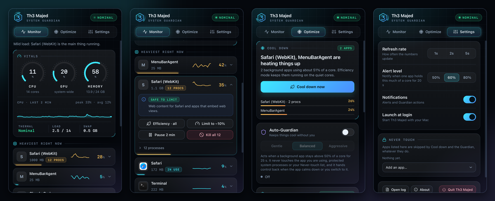

# Th3 Majed

**A menu bar app for macOS that shows what is really heating up your Mac, explains it in plain English, and cools it down for you.**

Th3 Majed sits beside the clock. Click it and you get live vitals (CPU, GPU, memory, thermal state), a ranked list of the apps responsible, and real controls on every one of them. One click on **Cool down** moves every busy background app into macOS's background priority class (**Efficiency mode**), so it runs on the efficiency cores and everything else gets priority. Switch on **Auto-Guardian** and it does that by itself, only ever to apps you are *not* using.



*Real screenshots of the running app, with live data from the author's Mac.*

## What's new in 1.1

- **A new interface.** Dark, instrument-cluster design with live gauges, a two-minute CPU trace, real app icons and three focused tabs: **Monitor**, **Optimize**, **Settings**.
- **Optimize that actually works.** Cool down, Auto-Guardian, a memory cleaner and a power card. Every optimisation is read back from the kernel to prove it took effect, and everything is undone when you quit.
- **"What is this?"** Plain-English notes for the processes everyone asks about (`mediaanalysisd`, `CGPDFService`, `duetexpertd`, `kernel_task`...), with a clear *safe to limit / limit with care / protected* verdict.
- **The blank white popup is fixed.** After days of uptime macOS can silently discard the panel's web view; older versions then showed an empty white popup until you restarted the app. 1.1 notices, reloads by itself within a few seconds, and is dark from the first frame so it can never flash white.
- **No more UI stalls.** Sampling runs on a background thread, and the menu bar label has a fixed width so nothing jumps around.

## What it does

### Monitor
- **Vitals:** CPU, GPU and memory gauges, a live total-CPU trace, macOS thermal state, load and swap.
- **Heaviest right now:** apps grouped by app, not by PID (Chrome with 70 helper processes is one card), with sparklines, real memory footprint (the number Activity Monitor calls "Memory") and the app's real icon.
- **Controls on every app** (tap a row): **Efficiency mode**, **Limit to ~10%**, **Pause 2 min**, **Quit / Kill**, and for services **Stop permanently** via `launchctl`. Multi-process apps expand into a per-process list.
- **A plain-English verdict** at the top and a status chip: Nominal, Warm or Hot.

### Optimize
- **Cool down:** one click moves every busy *background* app to Efficiency mode. The app you are using is never touched. Nothing is frozen or closed.
- **Auto-Guardian** (off by default): does the same automatically.
  - **Gentle:** a background app above 80% of a core for 45 s.
  - **Balanced:** above 50% for 25 s.
  - **Aggressive:** above 30% for 12 s.

  It hands control back when the app calms down or the moment you switch to it, never acts on protected or system-owned processes, and skips anything on your **Never touch** list.
- **Memory:** pressure, used/total, swap and the heaviest apps, each with a **Quit** button (after a confirmation, and it is a polite quit, so apps with unsaved work ask first), plus **Quit N idle apps**.
- **Power:** battery, plugged-in state and Low Power Mode status, with a shortcut to Battery settings.
- **Under control:** everything Th3 Majed is currently limiting, with **Release** and **Release all**.

### Settings
Refresh rate (1s / 2s / 5s), alert level (50 / 60 / 80%), notifications, launch at login, and the Never-touch list (a dropdown of your running apps, no typing).

## How the optimisations work (and what they honestly can't do)

| Action | What really happens |
|---|---|
| **Efficiency mode** | Puts the process in macOS's background priority class with `setpriority(PRIO_DARWIN_PROCESS, PRIO_DARWIN_BG)`, the same policy the `taskpolicy -b` command applies. The scheduler then prefers the efficiency cores for it and gives everything else priority. The process keeps running; nothing is frozen. In testing, busy processes dropped from ~99% to ~29% CPU whenever the machine was saturated. After applying it, the kernel's own process flag is read back, and success is only reported if it took. |
| **Limit to ~10%** | Duty-cycles the process with `SIGSTOP`/`SIGCONT` so it can use roughly a tenth of a core. Always leaves the process running when it ends. |
| **Pause** | `SIGSTOP`, then an automatic resume after the timer. |
| **Quit** | After you confirm, asks the app to quit through macOS, so it can ask you about unsaved work. **Force quit** and **Kill** confirm too. |
| **Guardian** | Efficiency mode, applied and released by rules, never on the frontmost app. |

**What it cannot do, and says so instead of pretending:**
- It can only change **your own** processes. Root-owned system processes are shown but refused with a clear message; nothing is ever half-applied.
- It cannot purge memory, flush caches, or switch Low Power Mode on or off. macOS requires an administrator password for those, and Th3 Majed never asks for one. Memory is freed the honest way: by quitting apps you choose.
- GPU use is system-wide, not per process, because macOS does not expose per-process GPU use without a privileged helper.
- There is no temperature sensor reading. The **thermal state** shown is macOS's own (`Nominal / Fair / Serious / Critical`), which is what the system itself uses to decide when to throttle.

### Safety

- **Protected by design.** `WindowServer`, `loginwindow`, `launchd`, `kernel_task`, `SystemUIServer` and friends have no controls at all. `Dock`, `Finder`, `ControlCenter` and similar are never touched by Cool down or the Guardian.
- **Exact PID, re-verified.** Every action re-checks that the PID still belongs to the expected process, so a recycled PID can never be hit.
- **Crash-safe.** Every limit, pause and efficiency change is written to disk the moment it starts. If Th3 Majed quits, is force-quit or crashes, everything is restored (on a clean quit immediately, after a crash on the next launch).
- **Full audit log** of every action with exact PIDs and timestamps (**Settings → Open log**).

## Processes people ask about

| Process | What it is | Safe to limit? |
|---|---|---|
| `mediaanalysisd` | Photos / Visual Look Up / Live Text analysis: scans your library for faces, objects, scenes and text. Can run for hours or days after a big import, an iCloud Photos sync or a macOS update, then stops by itself. | Yes: Efficiency mode. Killing it just makes macOS restart it from the beginning. |
| `CGPDFService` | A sandboxed Core Graphics helper that parses and draws PDFs for Preview, Quick Look, Finder thumbnails and Spotlight. Spikes when a folder of large PDFs is being previewed or indexed. Restarts on its own if closed. | Yes. |
| `duetexpertd` | Part of CoreDuet, Apple's on-device intelligence: learns usage patterns for Siri suggestions and background scheduling. | Yes. |
| `BackgroundShortcutRunner` | Runs Shortcuts automations in the background. Sustained high CPU usually means a Shortcut is looping. | Yes. |
| `mds` / `mds_stores` / `mdworker` | Spotlight indexing. | Yes. |
| `kernel_task` | macOS itself. It deliberately soaks up CPU to cool the chip, so high usage means the Mac is already protecting itself from heat. | Protected. |

Th3 Majed shows this explanation inside the app when you open one of these.

## Install

1. Download the latest `Th3Majed.dmg` from the [Releases page](../../releases).
2. Open it and drag **Th3 Majed** into **Applications**.
3. Launch it from Applications (or Spotlight). It has no Dock icon by design; it only lives in the menu bar.
4. **First launch only:** the app is signed ad hoc rather than with a paid Apple Developer certificate, so Gatekeeper will say it cannot be verified. Right-click (or Control-click) the app → **Open** → **Open** again. You only need to do this once.

To start it with your Mac, switch on **Settings → Launch at login**.

## Requirements

- macOS 13 (Ventura) or later
- **Apple Silicon (M1 and later).** This build is arm64-only. Intel support only needs a build run on an Intel Mac; the source has no Apple-Silicon-specific code.

## Where it keeps things

Everything lives in `~/Th3Majed/`: `config.json` (your settings), `th3majed.log` (the audit log) and `active_state.json` (the crash-recovery record, present only while something is limited).

## Uninstall

```bash
# Turn off Settings → Launch at login first, or remove the login agent by hand:
launchctl bootout gui/$(id -u)/com.majed.th3majed 2>/dev/null
rm -f ~/Library/LaunchAgents/com.majed.th3majed.plist

rm -rf /Applications/Th3Majed.app
rm -rf ~/Th3Majed        # optional: settings and log
```

## Building from source

```bash
git clone https://github.com/VercaaLLC/Th3-Majed.git
cd Th3-Majed
./build.sh
```

This produces `build.noindex/dist/Th3Majed.app` (fully standalone, no system Python needed) and `build.noindex/Th3Majed.dmg`. The `.noindex` folder is deliberate: Spotlight ignores it, so a build copy never appears next to the installed app when you search for "Th3 Majed".

Requires Xcode Command Line Tools with the license accepted (`xcode-select --install`, then `sudo xcodebuild -license accept`).

To iterate without freezing each time:

```bash
python3 -m venv venv && source venv/bin/activate && pip install -r requirements.txt
TH3_HOME=/tmp/th3dev python3 th3majed.py      # TH3_HOME keeps a test copy's settings and log separate
```

## Tests

```bash
./venv/bin/python3 tests/test_engine.py
```

55 checks against **real processes** the script spawns itself (disposable `yes` busy loops, never anything of yours): Efficiency mode applied and read back from the kernel, Cool down, the Guardian acting and releasing, hard limits, pause and auto-resume, refusal of root-owned and protected processes, crash recovery, clean shutdown, settings validation and a real polite quit.

`tests/panel_selftest.js` drives the real panel inside a running app (clicking its actual buttons) and `tools/snapshot_panel.py` renders the real panel off-screen to produce the screenshots above.

## Project layout

| File | What it is |
|---|---|
| `th3majed.py` | The AppKit shell: status item, popover, supervised web view (self-heals), background sampler and the JS↔Python bridge. |
| `engine.py` | All the logic: metrics, grouping, optimisations, safety guards, every process action. No UI code. |
| `panel.html` | The panel itself: plain HTML/CSS/JS in a `WKWebView`. |
| `tests/`, `tools/` | The test suite and the screenshot tool. |
| `make_icon.py` | Generates the app icon natively with AppKit. |
| `Th3Majed.spec`, `build.sh` | PyInstaller spec and the one-command build. |

## License

MIT. See [LICENSE](LICENSE).
